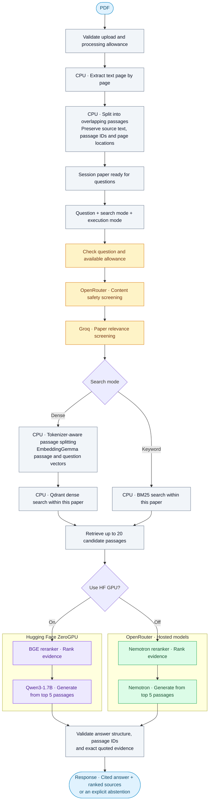

# PaperTrail

A research paper Q&A demo with inspectable sources, grounded answers, and PDF support.

[Try PaperTrail on Hugging Face](https://huggingface.co/spaces/AdarshRL/PaperTrail).
The Space installs a pinned revision of this repository; its `SOURCE.json` records the deployed revision.

## How it works

PaperTrail turns a PDF into searchable, page-linked passages, retrieves evidence for your question, and generates an answer with inspectable citations. PDF extraction, chunking, embeddings and retrieval run on the Space CPU. The **Use HF GPU** switch selects where reranking and answer generation run.



Both execution paths use OpenRouter safety screening and Groq relevance screening before retrieval. Turning on HF GPU moves reranking and generation to ZeroGPU; it still requires those external screening services. Screening can stop a request before evidence processing. Quota limits, unavailable providers or failed validation produce a clear status instead of an unchecked answer.

Dense indexing checks the actual encoder token budget and splits oversized passages into smaller source slices without truncating their text. The answer models receive the highest-ranked evidence, and the app checks citations against the passages supplied to the model. These checks establish citation and quote consistency; they do not guarantee that every answer is correct.

## Highlights

| Capability | What you get |
| --- | --- |
| Inspectable answers | Cited passage IDs, quoted evidence and page-linked PDF sources |
| Two inference paths | HF ZeroGPU with BGE + Qwen3, or hosted Nemotron models through OpenRouter |
| Two retrieval modes | EmbeddingGemma dense search or BM25 keyword search, scoped to the selected paper |
| Text PDF support | Up to **5 MB** and **20 pages** per upload; session-scoped paper processing |
| Demo corpus | **10 QASPER training papers**, **1,069 passages** and **18 example questions** |
| Durable allowances | Visible remaining counts that persist across refreshes and new tabs on the same network |

The corpus figures describe the demo's scale, not a held-out accuracy benchmark. Scanned PDFs require OCR before upload.

## Browse the sample corpus

Requires Python 3.12 and `uv`.

```powershell
uv sync --locked --extra app
uv run python scripts/download_qasper.py
uv run paper-evidence build --source data/qasper-train-v0.3.json --sha256 9458bfe76074a8fa8d1685af02bcc73537aa6d338ad20591dfaff1946bc88bf4
uv run paper-evidence-app --artifacts data/build
```

Open `http://127.0.0.1:7860` to browse papers and inspect passages. This setup does not accept new questions or generate answers. New questions require query screening. The app uses Groq for screening when you provide `GROQ_API_KEY` through the environment and pass `--enable-groq`. With screening configured, the app can return ranked passages.

To generate answers, also acquire the pinned reranker and answer model, then pass both model directories to the app. The app supports local CPU inference. Model acquisition and inference need the optional `embeddings` dependencies:

```powershell
uv sync --locked --extra app --extra embeddings
uv run python scripts/download_reranker_model.py --output models/bge-reranker
uv run python scripts/download_answer_model.py --output models/qwen3
uv run paper-evidence-app --artifacts data/build --enable-groq --reranker-directory models/bge-reranker --generator-directory models/qwen3
```

Set `GROQ_API_KEY` in the process environment before launch. Query screening sends the question and selected paper context to Groq. If you enable hosted answer features, the app may send questions and relevant excerpts to the configured provider. Do not submit confidential, personal, or unpublished material. PDF uploads are session-scoped and are not added to the shared corpus, but provider-backed features can transmit relevant text for processing.

Dense search measures uploaded passages with the pinned encoder tokenizer, including prompt and special tokens. Passages that exceed its budget are split into exact source slices and indexed separately, preserving the complete text and page locations without truncating chunks.

When usage limits are enabled, allowances follow the server-resolved client network across page refreshes and new tabs. Only salted hashes are stored in the usage ledger. Visitors sharing a connection may share an allowance; changing networks can create a different anonymous identity.

## Data and licensing

QASPER training data is downloaded separately under its CC BY 4.0 terms. See the [dataset card](https://huggingface.co/datasets/allenai/qasper) and each model card before redistributing data or weights. This project does not bundle model files or datasets.

## License

The code is distributed under the Apache License 2.0. Dataset and model licenses are separate.

## Run tests

Install the app and evaluation dependencies, then run the deterministic test suite:

```powershell
uv sync --locked --extra app --extra evaluation --group dev
uv run pytest -q
```
